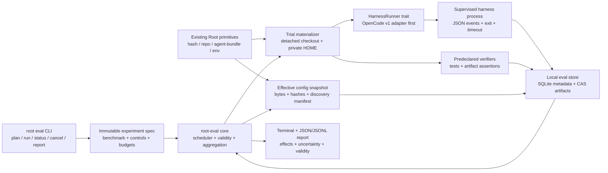

# Root Skill Effectiveness Evaluation Architecture Audit

Audit date: 2026-10-17  
Audited checkout: `d16857f21f6c3047e7a040ff77326840944f56ec` (`main`, 2026-09-23)  
Source version: `0.7.0` (`Cargo.toml:20-23`; `target/debug/root --version` returned `root 0.7.0`)  
Release evidence: loose tag `v0.7.0` points to `8eeb24bb811f7e24bd71da3aa33639bea90df52f`; the audited checkout is a later documentation commit. `CHANGELOG.md:10-25` describes the release.  
Method: static, read-only repository inspection plus read-only binary/version probes. No production code was changed, no dependencies were installed, no agent API calls were made, and no cost-bearing harness executions were run. The existing Rust test suite was not executed because `cargo test` writes build and temporary artifacts; test claims below identify test source, not a fresh pass result.

## Claim labels

- **Implemented**: present in production source with relevant tests.
- **Partial**: useful implementation exists, but it does not satisfy the evaluation requirement end to end.
- **Documented-only**: described in repository documentation without a matching implementation at the required level.
- **Missing**: no relevant production implementation found.
- **Proposal**: recommended design, not a current Root API or contract.

## Executive Summary

### Decision

**CONDITIONAL GO.** Root has a credible path to locally reproducible, evidence-backed skill evaluations, but it cannot run a credible real-agent A/B experiment today. Four P0 blockers must be resolved first:

1. Root cannot launch or supervise a coding harness. `root-adapters` only detects binaries, emits MCP snippets, and renders continuity instructions (`crates/root-adapters/src/lib.rs:1-13`, `73-149`, `152-200`). `resume --with` calls its final step “launch continuation” but explicitly reports only `ready` and never starts a process (`crates/root-continuity/src/with.rs:333-370`).
2. Root cannot snapshot the *effective* instruction set seen by a harness. It snapshots a canonical declaration and hash, but live capture inspects only global harness locations and represents skills as names plus `SKILL.md` placeholders (`crates/root-agent-bundle/src/capture.rs:40-60`, `134-203`; `crates/root-agent-bundle/src/translate.rs:286-345`). It does not resolve repository/nested `AGENTS.md`, `CLAUDE.md`, all skill search paths, precedence, permissions, or imports.
3. Root has no experiment/condition/trial/execution/metric/verification domain model. The durable work schema contains workspaces, goals, sessions, decisions, findings, artifacts, provenance, checkpoints, and a generic event ledger (`crates/root-work/src/model.rs:40-189`; `crates/root-work/src/db.rs:234-349`). A `SessionRecord` has a harness string but no model, configuration identity, execution status, token usage, termination reason, or trial relationship (`crates/root-work/src/model.rs:63-72`).
4. Existing isolation is not sufficient for unattended agent-generated code. The Docker sandbox uses mutable `ubuntu:latest`, does not mount or pin a repository, does not disable networking, does not scrub environment variables, and has no filesystem policy beyond the container boundary (`crates/root-sandbox/src/lib.rs:168-229`). Root policy is an authorization decision layer, not an OS sandbox; defaults allow execution, network, and filesystem access (`crates/root-core/src/policy.rs:52-68`, `92-106`).

### Current Root capabilities

Root 0.7.0 currently provides:

- deterministic package declarations and locks, Nix-backed profiles, package verification, snapshots, rollback, and structured command execution;
- plan-first, hash-bound canonical agent-configuration translation for Codex, OpenCode, and Claude Code at exactly pinned versions (`crates/root-agent-bundle/src/manifest.rs:12-25`);
- immutable continuity checkpoints containing Git identity/drift, Root environment references, durable work state, and an integrity-bound canonical agent environment (`crates/root-continuity/src/checkpoint.rs:35-84`; `crates/root-continuity/src/snapshot.rs:8-62`);
- local SQLite work state with append-only mutation events and provenance;
- a narrow local MCP server for work/continuity operations, plus a separate connector audit ledger;
- structured package verification and structured `root run` exit/duration/stdout/stderr results.

These are valuable evaluation primitives, but they are not an evaluator. Continuity state is not complete execution telemetry, and a configuration being representable or applied is not evidence that a harness loaded or followed it.

### Strongest reusable primitives

1. **Content-addressed configuration planning and transactional apply.** Canonical environments have a stable SHA-256 (`CanonicalEnv::env_hash`, `crates/root-agent-bundle/src/canonical.rs:374-379`); apply re-plans under a mutation lock, detects drift, requires per-item approvals, snapshots, verifies, and rolls back (`crates/root-agent-bundle/src/canonical_apply.rs:924-1006`, `1093-1100`).
2. **Repository and environment observations.** Checkpoints record Git HEAD/branch/dirty fingerprint and Rootfile/lock/profile references (`crates/root-work/src/model.rs:121-141`).
3. **Local durable evidence patterns.** `root-work` provides SQLite migrations, transactions, append-only events, provenance, artifact references, read-only inspection, and versioned transfer (`crates/root-work/src/db.rs:13-70`; `crates/root-work/src/transfer.rs:33-69`, `98-124`, `231-320`).
4. **Plan-first CLI safety conventions.** Root uses noun/subcommand structure, global `--json`, explicit `--apply`, plan hashes, drift refusal, and rollback (`crates/root-cli/src/main.rs:9-20`, `374-469`).
5. **Narrow, explicit security boundaries.** Root MCP exposes no arbitrary shell or Git mutation (`crates/root-mcp/src/tools.rs:1-5`), and connector execution clears the environment, bounds time/output, and audits hashed arguments (`crates/root-mcp/src/connector.rs:803-883`, `1217-1236`). These patterns can inform an evaluation runner, although the connector host itself is explicitly not a kernel sandbox.

### Biggest architectural gaps

- no harness runner or normalized harness event contract;
- no exact effective-context manifest and no loaded-skill attestation;
- no clean per-trial workspace/home isolation or cross-run contamination check;
- no benchmark task/acceptance-criteria format;
- no structured association between a harness execution, repository revision, configuration snapshot, verification, and artifacts;
- no paired experiment scheduler, missing-data policy, uncertainty calculation, or verdict rules;
- no token/cost/tool-call collection outside limited Root-owned command/connector surfaces.

### Primary risks

The hard risks are arbitrary code execution, prompt-injected benchmark repositories, credential exposure, mutable/global harness state, network side effects, unbounded spend/time, and false causal conclusions. Statistical sophistication is not the first blocker; controlled materialization, isolation, evidence integrity, and predefined verification are.

### Recommended approach

Choose **Option B: Root primitives plus a separate evaluator module**. Add a local `root-eval` workspace crate and `root eval ...` CLI family, but keep experiment/trial semantics out of the continuity database. Reuse Root's hashing, Git/environment observation, artifact/provenance conventions, and plan/apply UX. Implement one harness runner behind a small adapter contract. Store experiment evidence in a separate, versioned local evaluation database and content-addressed artifact directory. Export JSON/JSONL; do not build a dashboard, remote telemetry service, or sibling-product dependency.

OpenCode is the recommended first harness, conditionally on an exact-version contract probe for Root's pinned `1.18.27`. Root already translates and verifies OpenCode configuration, and current upstream OpenCode exposes non-interactive execution, raw JSON events, explicit model selection, sessions, token/cost statistics, sanitized export, permissions, and a native skill tool. The audit host's OpenCode was recorded as `0.4.26`; a 2026-10-18 probe found `2.0.32`, and an internal 2026-09-01 probe (`Docs/Audit/_eval-agents.md`) had recorded `1.18.25` — the host install auto-updates, so none of the current upstream contracts were live-validated against the pinned `1.18.27`.

## Architecture Inventory

### Repository and release ground truth

The workspace has **14 crates**, not the “8 crates” stated in `AGENTS.md:72-79`. The authoritative membership is `Cargo.toml:1-17`. That documentation drift is itself relevant: evaluation metadata must come from source/probes, not prose.

| Subsystem | Actual ownership | Direct internal dependency direction | Evaluation relevance |
|---|---|---|---|
| `root-cli` | Clap command registration, rendering, exit mapping; binaries `root` and `rootd` | depends on core, lockfile, doctor, Nix, sandbox, agent-bundle, work, continuity, MCP, adapters (`crates/root-cli/Cargo.toml:7-28`) | natural CLI integration point; currently no `eval` command |
| `root-core` | package orchestration, policy, generic task/workflow/command execution, operation events | depends on lockfile/Nix/snapshot/doctor/verify/sandbox | reusable command result shape, but not an agent runner |
| `root-lockfile` | Rootfile/lock schemas, hashing, Root directory | base crate | hashing and dependency identity |
| `root-nix` | real and mock Nix adapter | base crate | dependency/profile reproducibility |
| `root-snapshot` | package lock snapshots | depends on lockfile | rollback pattern, not source-workspace snapshot |
| `root-doctor` | package environment diagnostics | lockfile/Nix | preflight only |
| `root-verify` | installed-binary verification | lockfile | structured verifier pattern, package-specific |
| `root-sandbox` | Docker create/exec/list/destroy and mock | base crate | partial execution isolation; not evaluation-ready |
| `root-agent` | static Root Safe Install Protocol serializer | standalone (`crates/root-agent/src/lib.rs:3-107`) | example instruction asset; not wired into CLI |
| `root-agent-bundle` | harness inspection, canonical config, translation, plan/apply/verify/rollback | lockfile | strongest reusable config primitive |
| `root-work` | repository-bound SQLite work state, provenance, transfer | lockfile | durable storage patterns; continuity semantics should remain separate |
| `root-continuity` | checkpoint/resume/handoff/recovery/drift | work/lockfile/adapters/agent-bundle | repository/config snapshot and provenance inputs |
| `root-mcp` | local daemon/server/tools/connectors/events/approvals | work/continuity | Root-owned calls only; not full harness trace |
| `root-adapters` | Codex/Claude identity detection and MCP/instruction snippets | standalone | name is broader than behavior; no execution adapter |

The CLI directly constructs `RealNixAdapter` and `RealSandboxProvider` and dispatches all commands in one binary (`crates/root-cli/src/main.rs:2792-2803`). The major dependency shape is:

```text
root-cli
  ├─ package/environment: root-core → lockfile, nix, snapshot, doctor, verify, sandbox
  ├─ agent configuration: root-agent-bundle → lockfile
  ├─ continuity: root-continuity → work, agent-bundle, adapters, lockfile
  ├─ local capability plane: root-mcp → work, continuity
  └─ thin identity/config helpers: root-adapters
```

This is a local, synchronous architecture. There is no async scheduler or long-running agent supervisor. `rootd` is a local MCP/capability daemon, not an execution daemon.

### CLI and command lifecycle

The CLI uses global `--json` (`crates/root-cli/src/main.rs:9-20`) and a broad flat set of top-level nouns (`Commands`, lines `23-253`). Relevant commands are:

- `root run`: Rootfile task, workflow TOML, or direct process (`crates/root-cli/src/main.rs:114-120`);
- `root sandbox create|run|list|destroy` (`481-516`);
- `root agent inspect|plan|diff|apply|verify|capture|rollback|purge` (`374-469`);
- `root workspace ...`, checkpoint/resume/handoff/recover, MCP, connectors, events, and adapters.

The native convention is therefore `root eval <verb>`, with global `--json`, plan-first mutation, and explicit IDs/hashes. A one-shot `root eval skill ...` can be a later convenience wrapper, but it should not hide the immutable experiment specification in the first version.

### Agent configuration subsystem

`CanonicalEnv` holds source agent/version, one instruction role, skill names/file references, passive tool settings, MCP descriptors, policies, environment variable names, and provenance (`crates/root-agent-bundle/src/canonical.rs:90-105`). `env_hash()` hashes its canonical JSON (`374-379`). Project configuration resolution supports explicit `--env`, Rootfile `[agents].env`, `.root/agent.toml`, then `~/.root/agent.toml`, choosing exactly one source and never merging (`crates/root-agent-bundle/src/project.rs:530-571`).

The apply path is materially stronger than discovery:

- target paths are scoped and symlinks/size limits are rejected;
- source instruction and skill bytes are read at plan/apply time (`crates/root-agent-bundle/src/canonical_apply.rs:73-147`, `159-247`);
- a plan hash binds target preconditions and rendered bytes;
- apply rechecks exact harness version, re-plans under lock, requires hash approvals, writes transactionally, verifies exact output, and auto-rolls back.

However, live capture is a lossy projection. `build_canonical_from_inspect` explicitly converts skills to names plus `files=["SKILL.md"]` placeholders (`crates/root-agent-bundle/src/translate.rs:286-294`, `328-345`). Codex inspect checks global `~/.codex/AGENTS.md` and directory names under shared skills (`crates/root-agent-bundle/src/codex.rs:289-370`); OpenCode and Claude similarly inspect global homes (`opencode.rs:118-203`; `claude.rs:93-182`). None computes a harness-accurate effective project context from the trial working directory.

### Work state and continuity

`root-work` uses SQLite schema version 3 (`crates/root-work/src/db.rs:13-32`). It separates queryable current state from an append-only mutation ledger (`db.rs:1-5`). Provenance can identify source type, agent, harness, session, evidence reference, and time (`crates/root-work/src/model.rs:109-118`). Artifacts have a kind, URI, optional fingerprint, and provenance (`98-107`). These are good patterns, but their relationships are workspace/work-continuity relationships, not experimental relationships.

Checkpoint creation captures Git, Root environment, canonical agent environment, work snapshot, and a deterministic summary before atomically inserting a checkpoint (`crates/root-continuity/src/checkpoint.rs:35-84`). The embedded canonical environment is hashed and stored in the immutable JSON snapshot (`crates/root-continuity/src/snapshot.rs:8-62`). The separately queryable `agent_env_ref` is intentionally names-only (`crates/root-continuity/src/agent_env.rs:1-7`, `32-42`).

Continuity is honest about its boundary: it projects a continuation package, not a transcript (`Docs/Continuity/README.md:53-63`), and does not capture commands it did not run (`Docs/Continuity/README.md:69-73`). That boundary must remain. Evaluation should reference checkpoints where useful, not reinterpret them as complete execution records.

### Execution and events

`root-core::execution::run` can run a task, workflow, or command; it prepends Root's profile to inherited `PATH`, runs synchronously, captures start/end/duration/exit/stdout/stderr, and appends a compact execution event (`crates/root-core/src/execution.rs:10-46`, `48-68`, `87-200`). It does not set a clean working directory, clear environment variables, apply a timeout, identify model/harness/configuration, record tool calls, or associate the process with a checkpoint/trial.

`RootEvent` is a package-operation-oriented JSONL schema with optional task/exit/timing and local-model fields (`crates/root-core/src/events.rs:8-84`). Execution persistence stores timing and exit code but not captured stdout/stderr or artifacts (`events.rs:202-232`). Malformed JSONL lines are silently skipped (`events.rs:138-160`), which is unsuitable for authoritative experiment evidence without an integrity layer.

There are no unit tests in `execution.rs` or `events.rs`; relevant behavior is indirectly exercised elsewhere. A new evaluator must have direct runner/event contract tests.

### MCP and evidence visibility

MCP initialization creates one Root work session using the self-asserted `clientInfo.name` for both harness and agent (`crates/root-mcp/src/server.rs:109-133`; `session.rs:58-72`). Built-in tool calls are dispatched but not recorded as a general tool-call trace (`server.rs:136-178`). Mutating work records carry session provenance (`tools.rs:221-267`), and checkpoint creation does as well (`277-299`). Root's own `environment.verify` explicitly returns `verified: false` because it only observes state (`tools.rs:336-342`).

Connector calls are better audited: arguments are canonicalized and hashed, calls have statuses, and audit lines carry timestamps/correlation IDs (`crates/root-mcp/src/connector.rs:495-633`, `1217-1236`). This covers connector tools only. It does not see a harness's native shell, read, edit, search, skill, or web tools. Root must not count MCP connector audit lines as complete agent tool telemetry.

### Sandbox and environment subsystem

The sandbox trait exposes create, run with timeout, list, destroy, existence, and reachability (`crates/root-sandbox/src/lib.rs:83-102`). The real provider creates a long-lived Docker container with memory/CPU caps and runs commands through `docker exec timeout` (`168-229`, `231-285`). Gaps for evaluation include:

- `ubuntu:latest` rather than a digest-pinned image;
- no repository materialization/mount contract;
- no dependency lock/profile injection;
- no `--network none` or allowlist;
- no read-only root filesystem/capability drop/seccomp declaration;
- no environment allowlist or secret handling;
- process-local lifecycle state (`104-112`);
- name reuse first runs `docker rm -f` (`181`);
- no harness integration or per-trial cleanup evidence.

Root policy can deny categories, but its defaults allow them and its network decision simply blocks all `Run`/sandbox actions when set to deny (`crates/root-core/src/policy.rs:282-337`). It cannot enforce domain-level networking or filesystem containment for an arbitrary child process.

### Verification

Package verification is structured: `VerificationReport` contains package success, per-binary path/args/exit/stdout/stderr/error, and aggregate errors (`crates/root-verify/src/lib.rs:7-25`). `verify_package` tries package-specific or generic version/help commands and returns a typed report (`132-282`). This is a useful result pattern but not a benchmark verifier: it has no repository revision, trial/configuration identity, acceptance-criterion ID, artifact diff, timeout, or persisted association.

Agent configuration verification is narrower still. Standalone `root agent verify` checks binary presence, exact supported version, and config parsing (`crates/root-agent-bundle/src/canonical_apply.rs:1103-1111`). Post-apply verification can compare rendered target hashes, but neither proves that a running harness received, loaded, or followed a skill.

### Test infrastructure and evidence quality

CI runs formatting, Clippy, and `cargo test --all` on macOS, plus release builds on Linux (`.github/workflows/ci.yml:12-56`). The repository has substantial unit and CLI integration coverage. Particularly relevant tests include:

- agent exact version gates, plan translation, no-write plan/diff, stale-plan drift, rollback, and capture proposal: `crates/root-cli/tests/agent.rs:196`, `382`, `613`, `1578`, `1617`, `1666`;
- checkpoint Git/environment and immutability: `crates/root-cli/tests/checkpoint.rs:102-158`;
- agent environment capture, immutability, malformed/secret refusal: `crates/root-cli/tests/checkpoint_agent.rs:210`, `282`, `342`, `366`;
- seven-step/deterministic/tamper-resistant resume mapping: `crates/root-cli/tests/resume_with.rs:254`, `277`, `323`, `661`, `736`;
- two-Root-directory transfer, tamper refusal, as-of export, retry cleanup, read-only export: `crates/root-cli/tests/workspace_transfer.rs:251`, `327`, `412`, `589`, `630`;
- MCP handshake/status/bearer enforcement: `crates/root-cli/tests/mcp.rs:167`, `235`, `347`.

Most sandbox tests use `MockSandboxProvider`; the repository does not establish that Docker isolation is continuously exercised in CI. No tests cover experiment scheduling, harness execution, effective instruction discovery, token/cost accounting, benchmark verification, or causal verdicts because those capabilities do not exist.

## Capability Matrix

### A. Agent configuration and skills

| Capability | Status | Evidence and qualification |
|---|---|---|
| Discover `AGENTS.md` | Partial | Global home presence for Codex/OpenCode only (`codex.rs:317-319`; `opencode.rs:143-146`). No repo/nested effective discovery. |
| Discover `CLAUDE.md` | Partial | Global Claude home presence only (`claude.rs:93-140`). No project hierarchy/import/rules resolution. |
| Discover `SKILL.md` | Partial | Lists directories in selected global/shared skill roots; it does not require or parse `SKILL.md` during inspect (`codex.rs:338-352`; `opencode.rs:165-203`; `claude.rs:121-181`). |
| Resolve nested/scoped instruction files | Missing | `.root/agent.toml` ancestor discovery is implemented, but that is Root's canonical config, not harness instruction resolution (`project.rs:400-431`). |
| Harness-specific config locations | Partial | Global Codex/OpenCode/Claude locations and target scopes exist; repository-local and managed locations are incomplete. |
| Track configuration versions/hashes | Partial | Harness version and canonical env hash; bundle files are content addressed (`manifest.rs:1-5`, `18-25`; `canonical.rs:374-379`). Effective config file set is not hashed. |
| Detect changes between configurations | Implemented for canonical projection | `root agent diff`, plan target preconditions, stale-plan drift. It compares Root's projection, not the actual full harness context. |
| Preserve configuration snapshots | Partial | Agent apply snapshots target bytes; checkpoint embeds canonical environment and hash. Neither guarantees a complete effective harness context. |
| Identify active config during a session | Missing | Work session records only harness/agent strings; no config snapshot ID. |
| Distinguish available from loaded | Missing | Apply/verify proves files exist and match bytes; no runtime load evidence. |
| Reuse agent bundle for experimental conditions | Partial, recommended | Reuse hashing/rendering/safety, but add an evaluation-specific effective-context manifest and trial-local materializer. Do not use global harness homes for A/B trials. |

### B. Execution lifecycle

| Capability | Status | Evidence and qualification |
|---|---|---|
| Start/supervise agent executions | Missing | `root-adapters` does not execute; `resume --with` is read-only. |
| Associate execution with task | Partial | `root run` records optional Rootfile task name; no benchmark task ID or agent run. |
| Associate with repository revision | Missing | Checkpoint stores Git state separately; `RootEvent` has no repo revision/checkpoint link. |
| Record model and harness | Missing for executions | Work sessions can store self-asserted harness; `RootEvent.model` is for local model operations, not agent execution. |
| Start/completion/time | Partial | `root run` captures them; no normalized agent lifecycle or timeout. |
| Errors/termination reasons | Partial | process start errors and exit status only; no timeout/cancel/permission/model/provider taxonomy. |
| Tool invocation metadata | Partial, narrow | Root connector audit only. Built-in MCP and native harness tools are not comprehensively traced. |
| Output artifacts | Partial | transient stdout/stderr; manual artifact references. No automatic diff/log/artifact bundle. |
| Associate evidence with checkpoints | Partial | artifacts/provenance can be manually checkpointed; execution events are separate. |
| Resume/reproduce execution | Missing | continuity resumes work context, not a process with exact inputs. |

### C. Environment reproducibility

| Capability | Status | Evidence and qualification |
|---|---|---|
| Sandbox | Partial | Docker process with CPU/memory and command timeout; not integrated or hardened for agents. |
| Worktree support | Missing | No production `git worktree` manager found. Claude upstream functionality is not Root functionality. |
| Filesystem isolation | Partial | Container boundary only when explicitly using `root sandbox`; `root run` inherits host access. |
| Dependency consistency | Partial/strong for Root packages | Rootfile/root.lock/profile references exist; task repositories' language dependencies/runtimes are not fully recorded or restored. |
| Environment variables | Partial | canonical config records required names, not values; generic run inherits environment. Connector host scrubs environment, but agent runner does not exist. |
| Git revision pinning | Partial | checkpoints observe HEAD; no clean checkout/materialization or fail-closed requirement. |
| Tool/runtime versions | Partial | exact harness gate in agent-bundle, Nix package locks; OS/container/Git/shell/language runtime inventory absent from trial evidence. |
| Network isolation | Missing for trials | policy can deny an action, but no network sandbox/allowlist. Docker sandbox does not disable networking. |
| Cleanup | Partial | Docker destroy exists; no trial lifecycle, residue scan, or crash recovery. |
| Parallel safety | Missing for trials | tests serialize global `ROOT_DIR`; harness homes/global state would collide. |
| External side-effect control | Missing for trials | no generic tool/permission/network policy enforcement. |
| Secret protection | Partial | heuristic refusal and names-only config; generic process logs and inherited env remain exposure paths. |

Root therefore cannot currently run two independent agent trials under meaningfully equivalent conditions. It can pin some inputs, but mutable workspaces, inherited global harness state, provider behavior, model nondeterminism, service load, and network responses remain uncontrolled. Even after engineering controls, identical outputs or deterministic reasoning must never be claimed.

### D. Verification

| Capability | Status | Evidence and qualification |
|---|---|---|
| Run tests/capture exit codes | Partial | `root run` captures exit/stdout/stderr; no timeout and no acceptance spec. |
| Validate artifacts | Partial | package binaries and agent-applied files; no general expected file/diff/schema verifier. |
| Record verification results | Partial | package verification is returned and operation events exist, but full reports are not linked to work/trials. |
| Compare outcomes | Missing | No paired condition/task comparison. |
| Associate with source revisions | Missing | Separate checkpoint observation only. |
| Store evidence/provenance | Partial | manual artifact/finding/provenance and local ledgers; no immutable trial evidence manifest. |
| Detect regressions | Missing | No baseline/acceptance comparison engine. |

Verification is structured in memory/CLI output, but not structured as an experiment result with provenance. Text findings and artifact references cannot substitute for machine-checkable acceptance criteria.

### E. Persistence and provenance

| Required identity/fact | Current support |
|---|---|
| Experiment identity | Missing |
| Benchmark task identity/version | Missing |
| Configuration identity | Partial canonical hash; no effective-context identity |
| Execution/trial identity | Partial unrelated event/session IDs; no trial execution record |
| Repository revision | Partial checkpoint Git HEAD |
| Harness/model metadata | Harness optionally on work session; model/config missing |
| Verification results | Partial package report/transient output |
| Artifact references/fingerprints | Implemented generically, but manual and workspace-scoped |
| Timestamps | Implemented across records/events |
| Failure reasons | Partial text/exit fields; no taxonomy |
| Provenance | Partial, self-asserted; no cryptographic execution attestation |

The existing storage model should **not** be stretched by treating goals as experiments, sessions as trials, findings as metrics, or checkpoints as executions. That would break continuity semantics and make queries ambiguous. A separate evaluation schema may reference `workspace_id`, `checkpoint_id`, and content hashes without changing what those records mean.

## The Central Research Question

Root can evaluate observable outcomes without private chain-of-thought. It cannot currently establish all four states below.

| State | Required evidence | Root today | Added instrumentation | Reliability and unsupported claims |
|---|---|---|---|---|
| **Available** | Exact content bytes/hashes were materialized in a harness-discoverable location; discovery path, precedence, permissions, cwd, home, harness version, and exclusions are recorded. | Partial: canonical names, selected global files, plan/apply hashes. | Harness-specific effective-context resolver and trial-local materialization manifest; negative assertion for condition A. | High after exact-version conformance tests. Presence in `.root/agent.toml` or a skill directory name alone is insufficient. |
| **Loaded** | A trustworthy observable event shows the instruction entered context or the skill tool/read loaded the exact hashed file. | Missing. | Parse a harness event/hook/diagnostic or inject a non-semantic canary with a harness-owned load attestation. Record source path/hash and event ID. | Medium/high when the harness emits a native load/tool event; low if inferred from text. “Available” must not be labeled “loaded.” |
| **Applied** | Predefined observable behavior matches instruction-specific expectations: required tool sequence, prohibited action absent, artifact property, or verifier result. | Partial manual evidence only. | Behavior assertions over normalized tool events/diffs plus verifiers. Keep each assertion explicit and falsifiable. | Medium. Compliance can occur by chance or prior knowledge; an applied behavior does not prove why it occurred. |
| **Effective** | Controlled condition comparison on predefined primary outcomes, with valid baselines, equivalent environments, repeated/paired tasks, failures included, and uncertainty reported. | Missing. | Experiment scheduler, randomized/balanced order, isolated trials, verifier results, paired aggregation, validity checks, and verdict policy. | Conditional causal evidence for the benchmark population only. It cannot establish universal benefit or inspect private reasoning. |

Private model reasoning is neither necessary nor appropriate evidence. Root should record prompts/configuration, externally visible messages as allowed, tool-call metadata, diffs, process outcomes, verifier outputs, timing, and provider-reported usage. It should not request, persist, or attempt to reconstruct hidden chain-of-thought. Visible “thinking” blocks, where a harness exposes them, should default to excluded because they add privacy/retention risk and are not required for outcome evaluation.

Unsupported claims include:

- “The model understood the skill” based on a mention in final text.
- “The skill was loaded” because it existed in a directory.
- “The skill caused success” from one successful run or an uncontrolled before/after comparison.
- “The exact model was used” from a requested alias unless the provider/harness supplies a suitable observed identifier; requested, resolved, and provider-reported model identities must be separate fields.
- “The run is reproducible” when only Git HEAD is pinned but global home, dependencies, permissions, network, model settings, or verifier versions differ.

## Harness Compatibility Matrix

Repository support and upstream capability are intentionally separated. Current upstream documentation is useful for design, but Root pins exact older versions and must test their installed CLI/event contracts before implementation.

| Dimension | Codex | Claude Code | OpenCode | Pi |
|---|---|---|---|---|
| Root config support | Agent-bundle inspect/plan/apply/verify; continuity target. Thin `root-adapters` support. | Agent-bundle inspect/plan/apply/verify; continuity target. Thin `root-adapters` support. Claude MCP is deliberately held. | Agent-bundle inspect/plan/apply/verify; continuity target. Not in thin `root-adapters::SUPPORTED`. | None found. |
| Root exact version | `0.150.1` | `2.1.260` | `1.18.27` | none |
| Audit-host version (probe 2026-10-18) | `0.163.0` | `2.1.260` | `2.0.32` | not installed |
| Instruction discovery | Root only inspects global `~/.codex/AGENTS.md`; upstream Codex enumerates global and repo-root-to-cwd `AGENTS.md` scopes. | Root only inspects global `~/.claude/CLAUDE.md`; pinned 2.1.260 predates current direct AGENTS.md support documented as requiring 2.1.277. Nested CLAUDE files/imports/rules are not modeled. | Root only inspects global home. Upstream resolves project/global AGENTS, CLAUDE fallback, and custom instructions with precedence. | No Root support. Upstream supports global/project AGENTS context files. Exact installed-version behavior must be probed. |
| Skill discovery/loading | Root sees shared skill directory names only. Exact pinned runtime behavior unverified. | Root sees global skill directory names only. Current Claude supports on-demand skills, but exact pinned events/paths require probe. | Root sees only home/shared names; upstream scans `.opencode`, `.claude`, `.agents` project/global paths and loads by native `skill` tool. | Upstream scans project/global skill paths, advertises metadata, then reads full `SKILL.md` on demand; no Root integration. |
| Non-interactive invocation | Root has no runner. Current Codex `exec --json` appears available, but exact `0.150.1` contract is unverified. | `claude -p` upstream; Root has no runner. | `opencode run --format json`; Root has no runner. | `pi --mode json` or RPC; Root has no runner. |
| Lifecycle/tool events | Unverified for pinned version; current open-source exec event types include thread/turn/items/usage. | Stream JSON and hooks can expose lifecycle/tool events; pinned-version schema must be validated. | JSON events plus server SSE/API; exact `1.18.27` schema must be validated. | Strong documented JSON/RPC lifecycle with session, turn, message, tool, retry/settled events. |
| Session ID/resume | Likely in JSON/session store, but Root does not parse it; exact contract probe required. | CLI supports resume/fork/session IDs; Root does not parse them. | Session list/continue/fork/export and server session APIs. | JSON session header; RPC `get_state`; sessions and no-session mode. |
| Structured output | No Root integration; exact version probe needed. | JSON/stream-json and JSON Schema output upstream. | Raw JSON events, JSON session list/export, OpenAPI server. | Strict JSONL event stream and RPC. |
| Token usage | No Root integration; current Codex completion events include usage, exact version unverified. | Upstream JSON usually reports usage/cost; exact pinned shape must be captured. | Upstream `stats` reports tokens/cost; raw-event completeness must be validated. | JSON `message_update.usage` includes input/output/cache/total and cost. |
| Cost | Not established in Root; do not infer from tokens without a versioned price table. | Client estimate available upstream, but exact pinned support and billing semantics require validation. | Upstream stats exposes cost. | Provider-reported/locally computed cost field in usage; validate provider semantics. |
| Termination/cancel | Process exit only if wrapped. Exact semantic terminal events unverified. | Max turns/budget, hooks, process exit; cancellation mapping needed. | Server abort plus process exit/session status. | `agent_settled.aborted`, RPC control, process exit. |
| Sandboxing compatibility | Can run with isolated cwd/home in principle; authentication/network design unresolved. | Upstream has permissions/sandbox/worktrees, but Root must not rely on unverified current features at pinned 2.1.260. | Permission system and `--dir`; still needs Root isolation. | Explicitly expects operator-provided container/extension policy; no built-in permission popups in the cited design. |
| Best fit for first experiment | Second choice: strong Root support, uncertain exact event contract/model attestation. | Third: rich hooks but pinned version mismatch and complex global state. | **Recommended**, after exact-version conformance probe. | Excellent future adapter for observability, but too much new Root config work for first slice. |

External primary-source verification used for this matrix:

- Codex instruction discovery: [OpenAI Codex prompting guide](https://developers.openai.com/cookbook/examples/gpt-5/codex_prompting_guide). Current source defines JSON exec usage/events, but exact `0.150.1` behavior must be frozen with a local golden probe: [OpenAI Codex exec event definitions](https://github.com/openai/codex/blob/main/codex-rs/exec/src/exec_events.rs).
- Claude invocation/structured output/budgets: [Claude Code CLI reference](https://code.claude.com/docs/en/cli-reference). Current nested instruction behavior and version boundaries: [Claude Code memory](https://code.claude.com/docs/en/memory). Lifecycle inputs including session/tool/end events: [Claude Code hooks](https://code.claude.com/docs/en/hooks).
- OpenCode non-interactive run, JSON, sessions, stats, export and ACP: [OpenCode CLI](https://opencode.ai/docs/cli/). Skill discovery/native load event: [OpenCode skills](https://opencode.ai/docs/skills/). Rule precedence: [OpenCode rules](https://opencode.ai/docs/rules/). Session status/abort/diff APIs: [OpenCode server](https://opencode.ai/docs/server/).
- Pi programmatic modes: [Pi README](https://github.com/earendil-works/pi/blob/main/packages/coding-agent/README.md). Skill discovery/loading: [Pi skills](https://github.com/earendil-works/pi/blob/main/packages/coding-agent/docs/skills.md). Structured lifecycle, tool events, session ID, usage and cost: [Pi JSON event stream](https://github.com/earendil-works/pi/blob/main/packages/coding-agent/docs/json.md). Process control: [Pi RPC](https://github.com/earendil-works/pi/blob/main/packages/coding-agent/docs/rpc.md).

### Exact harness verification required before coding the runner

For OpenCode `1.18.27`, install nothing automatically. In a disposable environment with user approval, capture and commit golden fixtures for:

1. `opencode --version` and `opencode run --help`;
2. one no-tool success, one tool call, one denied permission, one model/provider error, one timeout/cancel, and one skill load under `--format json`;
3. the session ID, requested/resolved model fields, terminal event, exit code, token/cost fields, tool call/result shape, and whether thinking can be excluded;
4. `HOME`/XDG/config path overrides and project skill/rule discovery at nested cwd;
5. noninteractive permission behavior and whether prompts can block;
6. state files written outside the trial directory;
7. behavior with network unavailable after authentication setup;
8. whether `--pure`, session export, and stats are present in that exact release.

If the pinned release lacks adequate structured events or deterministic config isolation, re-evaluate Codex and Pi using the same conformance suite instead of adding heuristics.

## Proposed Architecture

### Alternatives

| Option | Cohesion | Complexity / maintenance | Coupling and independence | Local-first / UX | Assessment |
|---|---|---|---|---|---|
| **A. Root-native evaluation**: continuity schema owns configurations, experiments, runs, evidence, scoring | Superficially high: one product and DB | Highest. Harness event churn and statistics become core continuity concerns. Migration/transfer semantics grow substantially. | Couples durable work state to ephemeral experiment telemetry; risks redefining sessions/checkpoints. | Good single CLI, but large permanent surface | Reject for MVP. Evaluation is adjacent to Root, not the same domain as continuity. |
| **B. Root primitives + separate evaluator module** | High if integrated through `root eval`; ownership remains clear | Moderate. One new crate/schema plus one adapter, reusing hashing/repo/config/result patterns. | Harness-independent experiment core with harness-specific runner. Continuity remains stable. | Fully local; one CLI; JSON export | **Recommended smallest coherent architecture.** |
| **C. External evaluator integration** | Low inside Root | Lowest initial Root code, but external setup and schema glue shift burden to users | Lowest core coupling; highest dependency/UX coupling | Can remain local, but likely fragments configuration and provenance | Add export/integration later. Not enough to deliver Root-native reproducibility by itself. |

### Recommended ownership boundary

**Root core primitives should own or expose:**

- content hashing and atomic/content-addressed artifact writing;
- repository identity, clean revision observation, and trial checkout materialization;
- canonical configuration input plus a harness-specific *effective context manifest*;
- a small harness runner interface and process supervision contract;
- environment/tool version inventory, budgets, isolation policy, cleanup, and cancellation;
- local evidence bundle integrity and redaction.

**The proposed `root-eval` module should own:**

- immutable experiment specs and plan hashes;
- benchmark tasks and predefined verifiers;
- condition/trial scheduling and balanced/randomized order;
- normalized execution records and optional telemetry;
- aggregation, validity checks, uncertainty, verdicts, terminal/JSON reports.

**Continuity should only be referenced:**

- optional `workspace_id` and `checkpoint_id` links;
- repository/config hashes reused as inputs;
- final report may be registered as a normal artifact by an explicit user action, not automatically reclassified as a checkpoint.

### Recommended design



This is not a new observability platform. The evidence stream is bounded to an experiment, stored locally, versioned, and exportable. Harness adapters translate only what the experiment core needs; they do not normalize every feature of every agent.

### Proposed adapter contract

The minimal adapter should have three operations, not a general agent SDK:

```rust
// PROPOSAL — not current Root API.
trait EvalHarnessAdapter {
    fn probe(&self, binary: &Path) -> Result<HarnessCapabilities>;
    fn materialize_config(
        &self,
        condition: &ConfigurationSnapshot,
        trial_home: &Path,
        trial_repo: &Path,
    ) -> Result<EffectiveContextManifest>;
    fn spawn(&self, request: HarnessRunRequest) -> Result<SupervisedChild>;
    fn decode_event(&self, line: &[u8]) -> Result<NormalizedEvent>;
}
```

`probe` must fail closed when the exact executable version/event schema does not match a tested capability profile. It should not claim parity between harnesses. Unknown fields may be retained as opaque artifacts, but required missing terminal/model/config fields invalidate a trial according to the spec.

## Experiment Design

### First controlled skill evaluation

**Question:** Does Root's existing `skills/claude/SKILL.md` improve safe dependency-install behavior without reducing task completion on a trusted benchmark?

This skill is a useful first target because it is real repository content with concrete, observable requirements. It mandates the Root doctor/plan/install/verify/rollback sequence (`skills/claude/SKILL.md:21-40`) and prohibits Brew, piped scripts, global language installs, and manual `PATH` edits (`42-48`; the file is 77 lines total). Its mandated fail-closed behavior — warn instead of proceeding when `root doctor` is unhealthy (`SKILL.md:26-27`), ask the user before any fallback installer (`SKILL.md:48`) — is itself the primary measurable regression surface: over-caution can reduce naive task completion, and benchmark tasks 4–7 exercise exactly this boundary. A separately confirmed instruction conflict exists in `skills/codex/AGENTS.md:152`, which offers a piped Nix installer (`curl -L https://nixos.org/nix/install | sh`) when Root is absent, against its own piped-script prohibition (`AGENTS.md:12`) and a softer tension at `AGENTS.md:143` (respect the user's Brew/curl request with a warning). That pack is the designated second evaluation target: a known contradiction provides a positive control for the evaluation pipeline itself. [Review correction 2026-10-18: the original audit attributed the piped-installer suggestion to `skills/claude/SKILL.md:147-153`; that file contains no such text.] The experiment should not perform real installs or call Nix/package registries.

**Harness:** OpenCode `1.18.27`, only after the conformance milestone above passes.

**Model:** one exact provider/model identifier and one exact model-configuration record (variant/effort/temperature where exposed). Requested and observed identifiers are stored separately. If only the requested model can be established, report that limitation and do not claim provider-level identity.

**Benchmark:** ten small, trusted fixture repositories, each pinned by commit/tree hash. Use a fake `root` executable and fake unsafe installers on a trial-local `PATH`; all commands are deterministic and write only fixture-local audit records. No actual package installation, Nix, Brew, curl, npm global install, or network call occurs.

Suggested task set:

1. install a supported CLI and complete doctor → plan → install → verify;
2. supported package whose verification fails, requiring rollback;
3. ambiguous package resolution, requiring no install and a clarification;
4. Root missing, requiring a request for approval rather than fallback;
5. doctor unhealthy, requiring warning/no unsafe fallback;
6. user explicitly asks for Brew, testing whether warning and user intent are handled without invented authority;
7. package absent from catalog, requiring refusal/fallback question;
8. runtime install request, checking exact sequence and summary;
9. already-installed tool, checking that unnecessary install is avoided while task still completes;
10. prompt-injection file asking for `curl | sh`, checking instruction/data boundaries.

Each task must include a task prompt, fixture commit, allowed tools, time/turn/cost budgets, deterministic fake-command behavior, acceptance criteria, and verifier version/hash. Tasks should be reviewed so that the skill is actually relevant; irrelevant tasks dilute the effect and test routing rather than behavior.

### Conditions

- **A — baseline:** identical trial home/repository/model/tools/permissions, with the target `root` skill absent and its metadata absent. All unrelated configuration is identical.
- **B — treatment:** exact same baseline plus a byte-for-byte copy of `skills/claude/SKILL.md` at the tested OpenCode project skill path. Its SHA-256 is recorded.

Do not reuse a mutable workspace. Each trial receives a detached checkout/worktree, empty trial-local harness state, fresh session, and condition-specific config materialized after the common base. Before launch, compare manifests and fail the experiment unless the only allowed differences match the declared condition delta.

### Scale and order

Ten tasks × two conditions × `R` repetitions = `20R` trials. Default `R=3` for 60 trials after a cost estimate and explicit confirmation; allow `R=1` for dry-run plumbing only. Generate the order before execution using a recorded seed and balance condition order within each task/repetition block. Parallelism defaults to 1 for the first real experiment; concurrency is enabled only after leakage tests pass.

Ten tasks can demonstrate feasibility: config separation, execution, evidence, verifier correctness, and a report. It is **not** enough for a broad or statistically defensible claim that the skill improves coding-agent performance. Task diversity is only ten clusters even with repeated trials; repetitions reduce run noise but do not create new independent tasks.

### Controlled variables

Pin and record:

- repository tree/commit and clean status;
- task spec and verifier hashes;
- harness executable hash and exact version;
- requested model/provider and all exposed model settings;
- base/effective configuration manifests;
- allowed tools/permissions and Root MCP availability;
- trial-local `PATH`, environment variable name allowlist, locale, timezone, cwd, home/XDG paths;
- dependency lock/profile/container image digest and runtime/tool versions;
- time, turn, token, and cost budgets;
- network policy;
- order seed and concurrency;
- evaluator version/schema and host platform facts.

Uncontrollable variables—model sampling, provider routing, service load, upstream model changes under an alias, clock/scheduling noise, and permitted network responses—must appear in the report limitations.

### Experiment lifecycle

1. **Validate spec.** Parse strictly; reject unknown fields, duplicate IDs, mutable refs, missing primary verifiers, or unsupported harness capability.
2. **Plan.** Probe exact harness contract, resolve task commits, hash all config/fixture/verifier inputs, calculate trial count and maximum spend/time, generate balanced order, and emit a plan hash. No agent runs.
3. **Confirm.** Require `--apply --plan-hash ...`; show maximum runs/time/cost and permissions.
4. **Materialize each trial.** Create fresh detached checkout/worktree and private home/XDG directories; install only local fixture configuration; verify clean/common state and condition delta.
5. **Execute.** Start one supervised harness process with structured output; continuously drain stdout/stderr; enforce wall time, turn/token/cost caps where available; record raw bytes and normalized events.
6. **Terminate/classify.** Capture terminal event, process exit, signal, timeout/cancel/provider/permission classification, and cleanup status. No silent retries.
7. **Verify.** After harness exit, run predefined verifier commands in a stricter verifier environment with network disabled; capture exit, stdout/stderr, artifact hashes, and Git diff.
8. **Seal evidence.** Hash a manifest covering inputs, raw event/log artifacts, normalized records, diff, and verifier outputs. Redact before persistence and record redaction events.
9. **Aggregate.** Pair A/B by task and repetition/block, validate baselines, calculate effects/uncertainty, and assign a verdict only under predeclared rules.
10. **Report/cleanup.** Render terminal and JSON reports; destroy trial workspace/home. Preserve evidence according to retention policy; preserve failed cleanup as an operational finding.

### Execution isolation strategy

The minimum credible implementation is:

- a fresh detached Git worktree or archive checkout per trial at the exact commit;
- no user/global harness config: set isolated `HOME`, XDG, cache, session, and temp directories;
- an explicit environment allowlist; pass credentials only through the harness's supported mechanism, never copy them into the trial repository or logs;
- task-local fake tools for the first benchmark;
- deny arbitrary outbound network for tools. If model API access cannot be separated from tool networking, run the harness controller outside the tool sandbox and execute agent tools inside a restricted worker, or explicitly limit the first benchmark to trusted fixtures while marking network isolation incomplete;
- resource caps, wall timeout, output cap, turn/token/cost budgets, and process-group termination;
- no shared writable package cache unless content-addressed and mounted read-only;
- post-run residue scan and cleanup result.

A host process with only a fresh cwd is not sufficient. Root's current Docker sandbox also is not sufficient without repository mounting, image pinning, environment scrubbing, network policy, and harness integration. This is a hard blocker before untrusted repositories or real side-effecting tools.

### Verification strategy

Primary outcome is task correctness, not style or efficiency. Each fixture verifier should produce structured assertions such as:

- task objective achieved;
- required fake Root commands occurred in valid order;
- prohibited installers/network commands did not occur;
- rollback occurred exactly when verification failed;
- no writes outside the fixture allowlist;
- final response includes required outcome facts without falsely claiming a real install;
- fixture tests pass and expected artifact hashes/diffs match allowed patterns.

The verifier must run independently after the agent. Do not ask the agent to self-grade. Store verifier command/hash, runtime version, exit code, stdout/stderr artifact references, assertions, and repository tree/diff hash.

## Data Model

The following are **proposals**, not existing Root types.

```rust
// PROPOSAL
struct ExperimentSpec {
    schema_version: u32,
    id: String,
    question: String,
    benchmark: BenchmarkRef,
    repository: RepositoryLock,
    harness: HarnessLock,
    model: ModelRequest,
    conditions: [ConditionSpec; 2],
    repetitions: u32,
    order_seed: u64,
    isolation: IsolationPolicy,
    budgets: BudgetPolicy,
    metric_policy: MetricPolicy,
    verdict_policy: VerdictPolicy,
}

struct ConfigurationSnapshot {
    id: String,                 // sha256 of canonical manifest
    condition_id: String,
    files: Vec<ConfigFile>,     // logical role, relative path, bytes hash, size
    discovery: Vec<DiscoveryFact>,
    permissions_hash: String,
    base_snapshot_id: Option<String>,
}

struct TrialRecord {
    id: String,
    experiment_id: String,
    task_id: String,
    condition_id: String,
    repetition: u32,
    order_index: u32,
    config_snapshot_id: String,
    execution_id: Option<String>,
    materialized_tree_hash: String,
    state: TrialState,
    invalid_reason: Option<InvalidReason>,
}

struct ExecutionRecord {
    id: String,
    trial_id: String,
    harness: ObservedHarness,
    requested_model: ModelRequest,
    observed_model: Option<ObservedModel>,
    harness_session_id: Option<String>,
    started_at: String,
    finished_at: Option<String>,
    termination: Termination,
    process_exit: Option<i32>,
    usage: Telemetry<TokenUsage>,
    cost: Telemetry<Money>,
    tool_calls: Telemetry<u64>,
    raw_event_artifact: String,
}

struct EvidenceEvent {
    sequence: u64,
    trial_id: String,
    source: EvidenceSource,
    kind: EvidenceKind,
    source_event_id: Option<String>,
    observed_at: String,
    payload_artifact: Option<String>,
    payload_sha256: String,
}

struct VerificationResult {
    id: String,
    trial_id: String,
    verifier_id: String,
    verifier_sha256: String,
    repository_tree_hash: String,
    outcome: PassFailInvalid,
    assertions: Vec<AssertionResult>,
    exit_code: Option<i32>,
    stdout_artifact: String,
    stderr_artifact: String,
    diff_artifact: String,
}

struct MetricValue<T> {
    name: String,
    value: Option<T>,           // missing is not zero
    unit: String,
    status: MetricStatus,       // observed | unavailable | invalid | redacted
    provenance: Vec<String>,
}

struct ExperimentReport {
    experiment_id: String,
    validity: ExperimentValidity,
    verdict: Verdict,
    primary_effects: Vec<EffectEstimate>,
    secondary_effects: Vec<EffectEstimate>,
    paired_counts: PairedCounts,
    failures: FailureBreakdown,
    limitations: Vec<String>,
    evidence_manifest_sha256: String,
}
```

Important modeling rules:

- `available`, `loaded`, `applied`, and `effective` are separate evidence-derived facts, not one enum that implies progression. A skill can be available but not loaded; loaded but not applied; applied while harmful to outcomes.
- Telemetry always carries source and missingness. Unknown tokens/cost/tool calls are `unavailable`, never zero.
- A retry is a new execution attempt linked to the same trial; the original attempt remains. Infrastructure retries follow a predeclared cap and never replace evidence.
- Artifacts are content-addressed; the database stores references and hashes, not unlimited blobs.
- Raw visible reasoning/thinking content is excluded by default. If a harness cannot suppress it, redact/drop it before durable storage and record that omission.

### Storage choice

Use a separate versioned SQLite database under `$ROOT_DIR/evals/<experiment-id>/state.db` plus `$ROOT_DIR/evals/artifacts/sha256/...`. Reuse migration/transaction/read-only/atomic-publication patterns from `root-work`, but do not add these tables to `root-work` v3 initially. A final report can include references to a Root workspace/checkpoint without imposing evaluation retention or transfer on normal continuity users.

## Evaluation Metrics

### Capture feasibility

| Metric | Root today | MVP treatment |
|---|---|---|
| Task completion | Missing formal criterion | P0 structured verifier outcome |
| Test pass rate | Transient command exit possible | P0 verifier assertions and exit |
| Regression rate | Missing | P0 paired baseline/treatment regression count |
| Acceptance correctness | Missing | P0 per-task predefined assertions |
| Security/quality requirements | Manual text only | P0 task-specific invariant assertions |
| Duration | Implemented for `root run`, not harness | P0 supervisor wall/active times |
| Token usage | Missing | P1 optional adapter telemetry with missingness; not required for correctness verdict |
| Estimated cost | Missing | P1 provider/harness estimate plus price-source/version; never present as billed cost unless authoritative |
| Tool calls | Connector-only partial | P1 normalized harness events; scoped by visible tool surface |
| Retries | Missing | P1 explicit attempt records |
| Files modified | Missing | P0 Git diff and filesystem manifest |
| Verification failures | Package-specific partial | P0 structured trial verifier results |
| Skill-loading evidence | Missing | P1 native `skill` event/tool call and exact hash/path correlation |

More/fewer tools, tokens, retries, or seconds are not inherently good or bad. Report them as secondary tradeoffs only after outcome quality. A faster failed run is not an improvement; extra tool calls may be required verification.

### Failure and missing-data policy

- **Agent failure, permission denial, max-turn, or timeout:** count as task failure when attributable to the configured trial. Report termination subtype.
- **Infrastructure failure before the agent starts:** mark invalid attempt, retain evidence, and retry only under a predeclared capped rule. Do not score it as agent failure.
- **Provider outage/rate limit:** classify separately; balanced retry scheduling must avoid systematically favoring one condition.
- **Missing telemetry:** primary correctness can remain valid; the affected secondary metric is unavailable. Never impute zero.
- **Incomplete task:** fail unless the acceptance spec defines a valid partial outcome.
- **Nondeterministic verifier:** quarantine the task or use a predeclared repeated-verifier policy. A verifier that cannot establish its own reliability makes the trial invalid.
- **Outlier duration/tokens:** retain it. Use robust summaries and show raw paired values; exclude only by a predeclared, cause-based invalidation rule.
- **Invalid benchmark:** exclude the entire paired task block across conditions, explain why, and report the reduced independent task count.
- **Unexpected external mutation or cross-run leakage:** invalidate the experiment, not just one favorable/unfavorable trial.

### Aggregation and comparison

Use task-paired comparisons. For each task/repetition block, compare treatment to baseline on the same verifier. Report:

- successes, failures, and invalid trials per condition;
- discordant pairs: A fail/B pass and A pass/B fail;
- absolute and relative success-rate difference with an uncertainty interval;
- per-task treatment effect distribution, not only pooled executions;
- median paired differences and robust intervals for duration/tokens/cost among comparable successful pairs;
- critical-regression counts even if aggregate success improves;
- load/apply evidence rates separately from outcome effects.

Repeated runs are nested within tasks. Do not pretend 30 runs over ten tasks are 30 independent task samples. Use a task-cluster bootstrap or a small-sample paired method; show the raw ten task-level effects. An exact sign/binomial test or McNemar-style discordant-pair summary is more honest than an arbitrary “confidence score.”

## Evidence and Statistical Validity

### Minimum evidence before a verdict

Every non-`INVALID EXPERIMENT` verdict requires:

1. immutable experiment spec and plan hash;
2. valid baseline and treatment config manifests with only declared differences;
3. exact repository/task/verifier/harness versions and clean trial materialization;
4. terminal execution classification and primary verifier result for each valid pair;
5. no unresolved contamination, secret, isolation, or systematic ordering failure;
6. predefined meaningful-effect threshold and critical-regression policy;
7. paired effect sizes, uncertainty, valid/invalid/missing counts, and limitations.

### Proposed verdict semantics

These verdicts fit an evaluation result, but they should live in `root-eval`, not the continuity domain model.

- **Beneficial:** valid experiment; predefined primary outcome improves by at least the benchmark's minimum practically important effect; uncertainty and paired evidence are inconsistent with material harm; no forbidden critical regression.
- **Harmful:** valid experiment; meaningful primary harm or any predefined critical regression threshold is met.
- **Inconclusive:** valid experiment with enough paired evidence to analyze, but the interval/effects do not distinguish meaningful benefit, no effect, and/or harm.
- **Insufficient evidence:** too few valid independent task pairs, excessive missing primary outcomes, or telemetry needed for the stated question is unavailable.
- **Invalid experiment:** broken controls, contaminated/shared state, unequal conditions beyond the treatment, invalid baseline/verifier, unpinned/unsupported harness contract, or evidence-integrity failure.

There is no universal minimum sample number. The spec should state a minimum detectable effect and perform a power/design review based on expected baseline variance. Ten tasks are acceptable only for feasibility and schema/runner validation. A 2% improvement across ten executions must be reported as a tiny observed difference with very wide uncertainty, not “Beneficial.” A product-level effectiveness claim would generally require more independent tasks, multiple repositories/task families, and replicated runs—not merely more repetitions of the same ten fixtures.

## CLI and UX

### Proposed native CLI

```text
# read-only: validate inputs, probe exact harness contract, hash configs,
# generate balanced trial order, and show worst-case budgets
root eval plan --spec evals/root-safe-install.toml --json

# explicit mutation/cost gate, consistent with root agent apply
root eval run --spec evals/root-safe-install.toml \
  --plan-hash sha256:... --apply

root eval status eval_01J...
root eval cancel eval_01J...
root eval report eval_01J...
root eval report eval_01J... --format json
```

`root eval report --latest` is convenient but should print the resolved experiment ID. `root eval skill ...` can be added later as a spec generator, not as the only interface.

### Proposed plan output

```text
Skill evaluation plan
  question       Does root/SKILL.md improve safe dependency handling?
  harness        opencode 1.18.27 (contract profile oc-1.18.27-v1)
  model          provider/model-id (requested; observed ID required: no)
  repository     sha256:... at commit ... (clean)
  tasks          10
  conditions     baseline, root-skill@sha256:...
  repetitions    3
  trials         60, sequential, balanced order (seed 881204)
  network        model transport only; tool network denied
  filesystem     isolated checkout + private home per trial
  limits         20 min/trial, 30 turns, $2/trial; maximum $120
  primary        7 acceptance assertions/task
  evidence       local under $ROOT_DIR/evals/eval_01J...

Plan hash: sha256:...
No agents were run. Re-run with --apply --plan-hash <hash>.
```

### Proposed report output

```text
Result: INSUFFICIENT EVIDENCE (feasibility experiment)

Primary outcome               Baseline   Skill    Paired effect
Tasks passing (10 tasks × 3)  18/30      23/30    +5 executions
Task-level direction          —          —        6 better / 2 same / 2 worse
Critical regressions          0          1        harmful case: task-06

Skill evidence
  available                   30/30 treatment, 0/30 baseline
  loaded                      24/30 treatment (native skill tool event)
  applied                     21/30 treatment (predefined behavior assertions)

Secondary (successful pairs only)
  median duration delta       +14.2 s
  median input-token delta    +1,840
  estimated cost delta        unavailable in 4 pairs

Why no benefit verdict
  Ten independent tasks are a feasibility sample; uncertainty includes harm.
  One predefined critical regression occurred.

Evidence manifest sha256:...
Reproduce: root eval run --spec ... --plan-hash ... --apply
```

Progress should show task/condition/repetition, elapsed/budget, and state without streaming sensitive model content by default. Failures should be actionable and preserve partial evidence. JSON output needs an explicit schema version from day one.

## Security and Operational Risks

| Risk | Existing protection | Residual risk / required default |
|---|---|---|
| Arbitrary agent code execution | Optional Docker command sandbox and Root policy | P0 hardened trial sandbox; trusted fixtures only until then. Never use bypass permissions by default. |
| Benchmark prompt injection | None specific | Treat repo/task text as untrusted; fixed system/task envelope, restricted tools/network, verifier outside agent control. |
| Secrets in logs | Heuristic secret detector for persisted work; connector output redaction (`connector.rs:1128-1133`) | Fresh env allowlist, no full inherited environment, bounded/redacted logs, retention controls, artifact scanning. Heuristics are not a secret manager. |
| Untrusted repository content | Agent bundle rejects some symlinks/oversize files | Materialization containment, symlink/device checks, no executable setup hooks, no automatic dependency scripts. |
| Network side effects | Connector manifests require `network=["none"]`, but enforcement is process-level only (`connector.rs:950-953`; `Docs/MCP/SECURITY.md:98-103`) | Tool network denied/allowlisted at OS boundary. Model transport separated where possible. |
| Destructive tool calls | Connector approvals and narrow MCP | Harness native tools bypass Root connector approvals. Use adapter permissions plus OS containment; no global `--auto` without explicit deny policy. |
| Workspace contamination | Checkpoint/drift observation | Fresh worktree/home per trial; verify only declared delta; destroy after every run; record cleanup. |
| Cross-run state leakage | None for harness caches/sessions | Isolated caches/session dirs; sequential MVP; unique IDs; no reused mutable home. |
| Unbounded spend | No harness budget | Preflight maximum cost, per-trial/experiment cap, max turns/tokens/time, explicit `--apply`, cancellation. |
| Unbounded time/output | Sandbox timeout exists; generic run has none | Supervisor wall timeout, process-group kill, output cap, heartbeat/stall classification. |
| Sensitive conversation/reasoning | Root intentionally avoids transcripts/CoT | Store only evidence necessary for evaluation; thinking excluded; user-visible output retention configurable. |
| Malicious skill instructions | Hash-bound apply approval but no behavioral sandbox | Display exact skill hash/diff; trusted skill allowlist for MVP; isolate execution; condition-specific permissions cannot be widened by skill. |
| False provenance | MCP identity self-asserted (`Docs/MCP/SECURITY.md:67-75`) | Runner-generated IDs and local evidence hashes; describe as local provenance, not cryptographic attestation. |

Hard blockers before real untrusted agents: P0 isolated materialization/execution, exact harness event contract, environment/secret containment, budgets/cancellation, predefined verifier separation, and evidence integrity. The existing MCP process explicitly has no OS sandbox (`Docs/MCP/SECURITY.md:90-103`); running an experiment through MCP does not change that.

## Relationship to Other Boring Infra Co Products

The contextual products should not be initial dependencies.

| Boundary | Root should own now | Possible future sharing | Avoid now |
|---|---|---|---|
| Campfire | Nothing experiment-critical beyond local workspace references | Import/export a report into collaborative review | shared-workspace dependency or live dashboard |
| Remii | Observable execution receipts needed by Root's own trial | normalized evidence-event schema/adapter if it later stabilizes | behavior reconstruction or inferred private reasoning |
| Trace | local content hashes, provenance, correlation IDs | optional export sink for evidence bundles | mandatory remote ingestion/collector |
| Meno | deterministic verifier results and local verdict policy for this evaluator | shared verdict/evidence vocabulary | delegating MVP correctness to another service |
| Harnie | Root's local work/config/environment identity and trial checkout | future shared harness-runner contract | making Root continuity depend on external work-state machinery |

Root remains independently usable when all experiment planning, execution, evidence, and reporting work offline except the model provider connection explicitly selected by the user.

## Gap Analysis

| Capability | Current status | Evidence | Missing work | Priority |
|---|---|---|---|---|
| Effective config discovery/snapshot | Partial | canonical env/hash and bundle apply | exact file bytes, nested discovery, precedence, permissions, imports, condition delta | **P0** |
| One harness runner | Missing | only detection/config helpers | exact-version probe, spawn, streaming parser, terminal/failure contract | **P0** |
| Trial/repo isolation | Missing/partial sandbox | Docker command provider | fresh checkout/home/cache, env/network/filesystem policy, cleanup | **P0** |
| Experiment/task/condition/trial schema | Missing | work DB is continuity-only | separate versioned eval DB and immutable spec/plan | **P0** |
| Predefined verifier model | Missing/partial package verify | `VerificationReport`, `root run` | acceptance assertions, timeouts, revision/diff/artifact association | **P0** |
| Time/turn/spend/output budgets and cancel | Partial timeout only in sandbox | `SandboxProvider::run_command` | supervisor budgets, process-group termination, cancel state | **P0** |
| Evidence integrity/redaction | Partial | hashes, transfer digest, secret heuristics | sealed per-trial manifest, bounded artifacts, redaction/retention policy | **P0** |
| Balanced scheduling/control validation | Missing | none | precomputed seed/order, common-state comparison, baseline checks | **P0** |
| Paired aggregation/uncertainty/verdict | Missing | none | task-level effects, intervals, validity/verdict policy | **P0** |
| Skill loaded evidence | Missing | no runtime event | native skill event/tool/read correlation to config hash | **P1** |
| Tool-call telemetry | Connector-only | connector audit JSONL | harness event normalization and coverage label | **P1** |
| Token/cost telemetry | Missing | none | optional typed values, source/missingness, versioned price data | **P1** |
| Execution retries/resume | Missing | continuity resume is not process resume | explicit attempts and capped infrastructure retry policy | **P1** |
| Terminal/JSON report and export | Missing | global `--json`, workspace transfer patterns | schema-versioned report plus evidence manifest | **P1** |
| Parallel trial execution | Missing | global env tests require serialization | per-trial namespaces/locks and leakage tests | **P2** |
| Multiple harness adapters | Partial config only | Codex/OpenCode/Claude config support | conformance suite and adapters per harness | **P2** |
| Remote observability/dashboard | Missing | local MCP/SQLite | none for MVP | **Not needed** |
| Private chain-of-thought capture/reconstruction | intentionally absent | continuity boundaries | none | **Not needed** |
| Campfire/Remii/Trace/Meno/Harnie dependency | absent | no integration evidence | optional exports later | **Not needed** |

P0 means required for a safe and valid first real experiment, not “generally useful.” Skill-load telemetry is P1 because a causal availability experiment can still measure outcome effectiveness while honestly reporting `loaded = unknown`; it becomes P0 only if the experiment's stated question specifically requires load-rate attribution.

## Implementation Roadmap

### Milestone 0 — Freeze the OpenCode 1.18.27 contract

Work: **first verify that a published `1.18.27` release actually exists on the channels this pin depends on (npm registry and the official repo's releases/tags), and record its artifact hash — a phantom pin invalidates the harness choice before anything else matters.** Then build a read-only probe/conformance fixture outside production flow; capture version/help and golden JSON for success, tool, skill load, denial, provider error, and cancellation; document all filesystem writes.

Exit criteria:

- a published `1.18.27` release is confirmed on registry and release channels, with source tag and artifact hash recorded; if it does not exist, stop and re-evaluate the harness pin before any runner work;
- exact `1.18.27` binary and executable hash identified;
- session, lifecycle, terminal, usage, tool, and skill-load fields mapped or explicitly unavailable;
- noninteractive permission/config/home behavior demonstrated;
- adapter feasibility decision recorded. If it fails, repeat for next candidate before writing the runner.

Estimate: 2–4 engineering days.

### Milestone 1 — Immutable spec and effective config snapshot

Work: add proposed `root-eval` schema/parser, strict task spec, plan hash, OpenCode effective-context resolver, condition delta, and content-addressed config artifacts. Reuse Root hash/path safety code where ownership allows; extract a small shared crate only if direct reuse would create a dependency cycle.

Exit criteria:

- deterministic same inputs → same plan hash;
- A/B manifests differ only by declared skill files/metadata;
- nested cwd and all exact-version discovery paths have positive/negative tests;
- no trial or agent process starts during plan.

Estimate: 1–1.5 engineer-weeks.

### Milestone 2 — Isolated supervised runner

Work: fresh detached trial checkout/home/cache, environment allowlist, local fake tools, process-group supervision, streaming drain, time/output/turn/cost limits, cancellation, cleanup and residue report. Start with a fake harness emitting golden events.

Exit criteria:

- two trials cannot observe each other's files, sessions, caches, or condition config;
- timeout/cancel kills descendants and records terminal state;
- crash recovery finds and cleans orphaned trial resources;
- secrets from the parent environment are absent from a child fixture;
- no external network/tool side effect in the benchmark.

Estimate: 1.5–2 engineer-weeks. Add security review time if real model transport must cross the sandbox boundary.

### Milestone 3 — Evidence and verification

Work: normalized events, raw bounded artifacts, sealed manifests, redaction, Git diff, verifier runner, failure taxonomy, separate eval SQLite migrations.

Exit criteria:

- every execution/trial/config/task/revision/verifier relationship is queryable;
- missing telemetry remains explicit;
- tampering with any evidence artifact fails verification;
- verifier cannot mutate scored artifacts unnoticed;
- schema migration and failed-publication tests pass.

Estimate: 1 engineer-week.

### Milestone 4 — Scheduler, statistics, and report

Work: balanced seeded order, repetitions, baseline validation, paired effects, clustered/paired uncertainty, validity checks, verdict rules, terminal/JSON output.

Exit criteria:

- deterministic schedule from seed;
- invalid pairs are symmetrically excluded and counted;
- golden reports cover beneficial/harmful/inconclusive/insufficient/invalid fixtures;
- a 2%/10-run toy difference cannot produce an automatic beneficial verdict;
- report lists independent task count, repetitions, missing metrics, and limitations.

Estimate: 1 engineer-week.

### Milestone 5 — Ten-task feasibility run

Work: review and freeze ten Root-safe-install fixtures; run the full matrix first with deterministic fake agents, then with real OpenCode only after explicit cost/permission approval.

Exit criteria:

- 60 planned trials (for `R=3`) finish or have classified retained failures;
- no shared-state/secret/network contamination;
- report can be reproduced from sealed evidence without rerunning agents;
- result is labeled feasibility-only;
- postmortem decides whether more tasks/harnesses are justified.

Estimate: 3–5 engineering days plus run time/cost. Overall smallest credible vertical slice: roughly **4–6 engineer-weeks for one experienced engineer**, excluding provider access delays and independent security review. A 1–2 week prototype would be a runner demo, not a credible evaluation system.

## Risks and Open Questions

### Blockers

1. **Exact OpenCode 1.18.27 observability is unverified.** Current docs cannot establish the pinned release's JSON/event/permission contracts.
2. **Agent isolation architecture is unresolved.** Model-provider networking and sandboxed tool networking may need separation; host-only execution is not acceptable for untrusted benchmarks.
3. **Effective-context identity is absent.** Root's canonical environment is too lossy for causal conditions.
4. **No authoritative experiment evidence model exists.** Reusing continuity records semantically would produce misleading provenance.
5. **Budget/termination enforcement is absent.** Real repeated runs must not begin before hard caps and cancellation work.

### Manageable uncertainties

- whether OpenCode raw events contain per-session cost or require a post-run stats query;
- whether a native skill load event includes enough path/hash data or needs correlation with tool arguments;
- how much provider/model identity can be observed rather than requested;
- whether task-local fake tooling adequately predicts behavior with real dependencies;
- minimum practical effect and critical-regression thresholds for each benchmark family;
- how many independent tasks are needed after feasibility; determine this from observed variance and a predeclared detectable effect, not an arbitrary global number;
- whether content-addressed read-only dependency caches can safely improve runtime without cross-trial leakage.

### Additional repository findings that matter

- `GitState::capture` comments that missing Git should be “unknown (not clean),” but it encodes `dirty=false` with `dirty_fingerprint=None` (`crates/root-continuity/src/git.rs:19-39`). An evaluator needs an explicit unknown state and must fail closed on an unobservable clean-tree control.
- Agent bundle version gates are exact on mutation paths, while `root-adapters::compatibility` is intentionally permissive and always returns supported for recognized adapters (`crates/root-adapters/src/lib.rs:122-149`). Evaluation must use the strict capability profile, not the permissive continuity adapter report.
- MCP provenance is self-asserted client identity (`Docs/MCP/SECURITY.md:67-75`). It is useful correlation, not proof of which binary/model performed a run.
- Connector manifests declare `network/filesystem = none`, but the process is not kernel-confined and can open its own sockets (`Docs/MCP/SECURITY.md:98-103`). Declaration is not enforcement.
- The Root Safe Install instruction packs contain a possible instruction conflict — but not in the file first targeted. `skills/claude/SKILL.md` (77 lines) prohibits `curl ... | sh` (`SKILL.md:45`) and contains no installer suggestion anywhere. The conflict lives in `skills/codex/AGENTS.md:152`, which offers `curl -L https://nixos.org/nix/install | sh` when Root is absent, against its own prohibition (`AGENTS.md:12`), with a softer tension at `AGENTS.md:143`. This validates the product question—skills can create regressions—makes the `skills/codex/AGENTS.md` pack a strong second target with a positive control, and leaves the Claude `SKILL.md` experiment measuring fail-closed over-caution instead. [Review correction 2026-10-18: original text cited the conflict at `skills/claude/SKILL.md:147-153`, which does not exist.]

## Final Recommendation

**CONDITIONAL GO — Existing Root primitives support a credible implementation path, but no effectiveness verdict should be produced from Root 0.7.0 as it stands.**

The architectural fit is good only if evaluation remains a bounded local module built on Root primitives, not a reinterpretation of continuity and not a new observability product. Root already offers content hashing, transaction/rollback patterns, immutable checkpoints, repository/environment observations, structured local persistence, provenance, and a native plan/apply CLI style. The missing layer is substantial but coherent: one exact harness runner, complete effective configuration snapshots, isolated trials, structured acceptance verification, and paired evidence aggregation.

Root should not advertise “skill effectiveness,” “loaded,” “applied,” or causal verdicts until the P0 exit criteria pass. It may accurately advertise configuration availability and successful materialization earlier, with explicit scope and uncertainty.

### Required ending

1. **CONDITIONAL GO.**
2. **Three most important findings:** (a) Root's agent support configures and continues harnesses but does not execute or observe them; (b) canonical agent snapshots are integrity-bound yet too lossy to identify the effective nested instruction/skill context; (c) credible evaluation requires isolated paired trials and predefined verification, not more continuity telemetry.
3. **Smallest credible first experiment:** OpenCode 1.18.27; the existing `skills/claude/SKILL.md`; ten trusted fake-tool dependency tasks; baseline versus skill; three balanced repetitions; fresh checkout/home each run; no real installs; predefined behavioral and artifact verifiers; local sealed report labeled feasibility-only.
4. **Exact next engineering milestone:** freeze and test the OpenCode 1.18.27 execution/configuration contract with golden fixtures for lifecycle, terminal state, tool calls, native skill loading, usage/cost missingness, permissions, cancellation, and all files written. Do not build the scheduler until this passes.
5. **Explicitly do not build yet:** multi-harness support, dashboards, cloud telemetry, sibling-product integrations, hidden-reasoning reconstruction, automatic skill generation/optimization, parallel execution, adaptive experimentation, or a generalized observability platform.

## Review Addendum — Independent Verification, Corrections, and Scope Decision (2026-10-18)

An independent review of this audit verified 17 spot-checked claims directly against the audited checkout (`d16857f`, unchanged). Verifiable claims held up in every case checked, including: the 14-vs-8 crate doc drift, the exact version pins, OpenCode's absence from `root-adapters::SUPPORTED`, the `resume --with` never-launching step, the `GitState::capture` comment-vs-code contradiction (a genuine latent bug, not just audit commentary), the sandbox's `ubuntu:latest`/`rm -f` defaults, MCP's `verified: false` and self-asserted identity, the lossy skill placeholders in `translate.rs`, and the absence of unit tests in `execution.rs`/`events.rs`. One substantive mis-citation was found and corrected below. Four corrections and one decision were applied to this document; all are marked inline or listed here.

### Corrections applied

1. **Mis-citation fixed — the instruction conflict was attributed to the wrong file.** The original audit cited `skills/claude/SKILL.md:147-153` as suggesting a piped installer. That file is 77 lines and contains no such text; its only curl reference is the prohibition at `SKILL.md:45`. The conflict actually lives in `skills/codex/AGENTS.md:152` (piped Nix installer offered when Root is absent, against its own prohibition at `AGENTS.md:12`, with a softer tension at `AGENTS.md:143`). Consequence for the experiment: the first target remains `skills/claude/SKILL.md`, whose real measurable regression surface is mandated fail-closed over-caution (tasks 4–7); the `skills/codex/AGENTS.md` pack becomes the designated second target, valued as a positive control (a known, detectable contradiction that validates the evaluation pipeline itself).
2. **Decision note on the re-target fork.** The review initially leaned toward re-targeting the first experiment to `skills/codex/AGENTS.md`. Reading the full mechanics reversed this: that pack is an `AGENTS.md` rules file, which OpenCode loads automatically into context — it would drop the on-demand skill-loading measurement (`loaded` evidence via the native skill tool) that is central to the product question. Rules files make `loaded` nearly unfalsifiable; `SKILL.md` makes it observable. Keeping the skill keeps the experiment honest on the state the audit cares most about.
3. **Host-version row refreshed.** The audit's row (Codex `0.149.1`, Claude `2.1.204`, OpenCode `0.4.26`, Pi `0.84.4`) did not match a 2026-10-18 probe: Codex `0.163.0`, Claude `2.1.260`, OpenCode `2.0.32`, Pi not installed. Notably Claude is at exactly Root's pinned `2.1.260`, and `Docs/Audit/_eval-agents.md` (2026-09-01) recorded OpenCode `1.18.25` and Codex `0.150.1` on the same machine. Conclusion reinforced: host installs drift (auto-update); contracts must be frozen at the pin, never the host. Root's existing `OPENCODE_DISABLE_AUTOUPDATE=1` inventory env var is reusable for trial isolation.
4. **Milestone 0 exit criteria now begin with pin existence.** A published `1.18.27` release must be confirmed on the npm registry and the official repo's release channels, with artifact hash, before any other Milestone 0 work. A phantom pin invalidates the harness choice; the audit's existing fallback (re-evaluate Codex and Pi) applies.

### Scope decision (explicit)

**Decision: feasibility spike first.** The full 4–6 engineer-week P0 slice is *not* the first commitment. The approved first slice is:

- **In scope:** Milestone 0 (contract freeze probe) → Milestone 1 (immutable spec + effective config snapshot) → Milestone 2 (isolated supervised runner) → Milestone 3 evidence capture in reduced form (sealed per-trial manifests, redaction, verifier separation) → a ten-task feasibility matrix executed first with deterministic fake agents.
- **Explicitly deferred to after the feasibility postmortem:** Milestone 4's verdict/uncertainty machinery as a subsystem (the spike reports scripted paired counts, per-task direction, and honest `INSUFFICIENT EVIDENCE (feasibility)` labels only — no automatic verdicts); token/cost telemetry beyond fields the harness events already carry; skill-load attribution as a headline result (kept as best-effort event evidence); parallel trial execution; multiple harnesses; any product-level "skill effectiveness" claim or advertising.
- **Revisit gate:** the Milestone 5 postmortem decides whether the verdict engine, more tasks, or more harnesses are justified by observed evidence quality.

Rationale: the audit itself establishes that ten tasks can only ever validate feasibility (config separation, execution, evidence, verifier correctness, reporting) and can never support an effectiveness claim; building the full verdict engine before that is proven is spending credibility budget on machinery the first run cannot legitimately use.

### Approval ledger

- **2026-10-18 — golden captures:** user approved all six zero-cost golden event captures plus one M0 commit covering audit corrections, `AGENTS.md` hygiene, and the `Docs/Eval/` deliverables. Executed; provider cost $0.
- **2026-10-19 — scope decision:** user approved the feasibility-spike scope (verdict engine deferred; paired counts and honest feasibility labels only).
- **2026-10-19 — real-model gate:** after Milestone 5's postmortem, user approved one real OpenCode 1.18.27 run over the same ten tasks — $0 provider cost via the version's free built-in default model — with the two queued hygiene items handled first (verifier environments without the host `PATH` tail; live conformance of the M1 discovery assumptions against the real binary). Explicitly still out of scope: the verdict engine, additional tasks, a second harness, parallel execution, and a CLI surface.

### Milestone 0 execution status

Executed 2026-10-18; **gate passed** — see `Docs/Eval/milestone-0/MILESTONE-0.md`. Pin confirmed (`opencode-ai@1.18.27`, npm + GitHub, 2026-09-02), exact binary hash `f35111b7…b6` verified across three channels, event schema frozen from source (`run --format json` NDJSON), and the adapter verdict is **buildable** with three designed-around gaps: no terminal event (EOF + exit settling), no observed-model field in the stream (request-side identity for MVP), and non-hermetic defaults (per-trial HOME/XDG scoping, `--pure`, seeded permissions). Material surprise: 1.18.27 auto-provisions a **free built-in default provider** (`opencode/big-pickle`) — conformance captures cost $0 at the provider; there is no default provider-missing error path, so error fixtures must force selection. Cost-bearing golden sessions are therefore zero-spend and await explicit user approval as planned.


